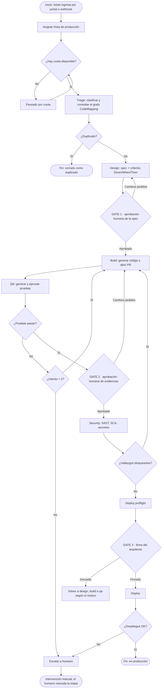
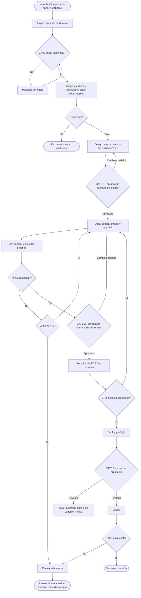
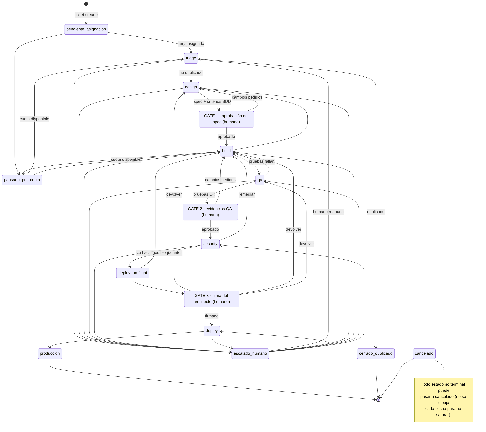
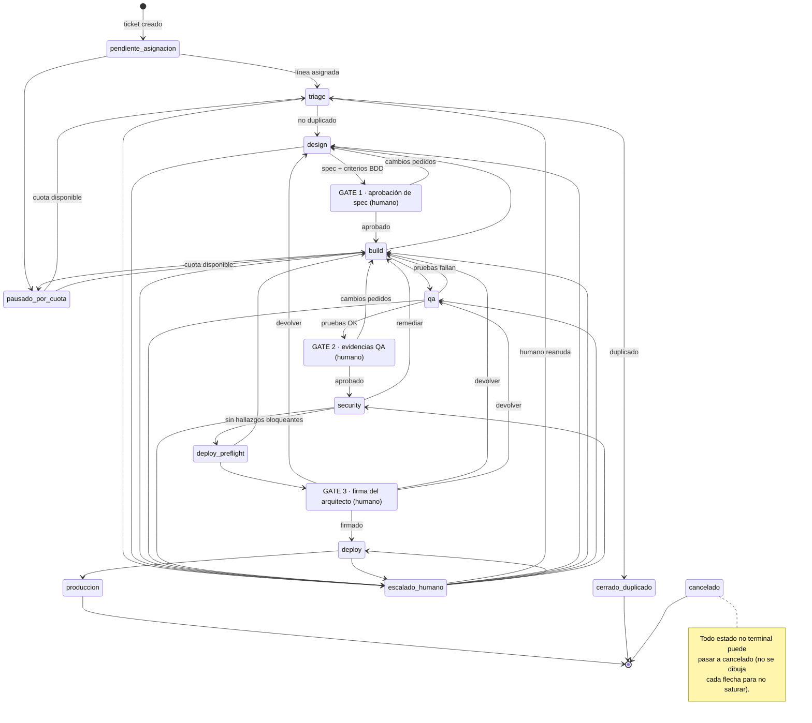

# Diagrama de Actividades y Máquina de Estados del Pipeline — KalliCode

**Versión:** `kallicode-backend`, rama `develop`, commit `f04519f` · **Fecha:** 28-10-2026 · **Responsable:** Luis Ibáñez (QA2)

**Fuentes en el código:**
- `packages/core/src/kallicode_core/pipeline/estados.py`: los 16 estados (`EstadoJob`) y la tabla `TRANSICIONES_VALIDAS`. Según el propio archivo, es un espejo exacto del `CHECK` de `core.jobs` y del router `/internal/v1`.
- `apps/workers/src/kallicode_workers/orquestador/politica.py`: la política de reintentos y escalado (`MAX_INTENTOS_POR_ETAPA = 2`).
- `apps/workers/src/kallicode_workers/orquestador/bucle.py`: las transiciones automáticas del orquestador.

## 1. Diagrama de actividades (flujo de un ticket)

Muestra el recorrido normal de un ticket y sus desvíos principales.





**Reglas que el diagrama refleja (verificadas en el código):**
- **Reintentos:** si una etapa falla, se reintenta. Si vuelve a fallar (2 intentos), **se escala a humano**. La escalación debería ser de severidad *alta* en triage, design, build y seguridad, y *media* en el resto. **Ver hallazgo H-07:** por un error de nombre, hoy la etapa de seguridad escala con severidad *media*.
- **Gates humanos:** los tres gates los decide una persona a través de la API. El orquestador no puede saltarlos. Según la matriz RBAC probada (caso CP-05), el Gate 3 solo lo puede firmar el rol `architect`.
- **Devoluciones:** el Gate 3 puede devolver el trabajo a design, build o qa. Un hallazgo de seguridad devuelve a build.
- **Cuota:** si la organización agota su cuota comercial, el job queda en `pausado_por_cuota` y se reanuda cuando hay cuota.

## 2. Máquina de estados completa del job

Todos los estados y todas las transiciones permitidas por `TRANSICIONES_VALIDAS`. Cualquier transición que no aparezca aquí la rechaza la API.





## 3. Estado de implementación (honesto)

| Parte | Estado en el repositorio |
|---|---|
| 16 estados y tabla de transiciones válidas | ✅ Implementado (`estados.py`, `CHECK` en `core.jobs`) |
| Historial de cada cambio de estado | ✅ Implementado (trigger `trg_jobs_transicion` → `core.job_transitions`) |
| Endpoint para cambiar de estado | ✅ `PATCH /internal/v1/jobs/{job_id}/state` |
| Transición triage → design / cerrado_duplicado | ✅ La hace `POST /internal/v1/tickets/{numero}/triage-result` |
| Política de reintentos y escalado | ✅ Implementada (`politica.py`) |
| **Transiciones automáticas del orquestador** (build → qa, security → deploy_preflight, deploy → producción…) | ⏳ **Pendiente.** El mapa de `bucle.py` está vacío, con la nota *"Sprint 6 añadirá"*. Es trabajo del equipo dueño del orquestador (E2) |

## 4. Diferencias con el diagrama de actividades anterior (`Diagrama_de_Actividades.md`)

| El diagrama anterior dice | El código dice |
|---|---|
| Máximo **3** reintentos antes de escalar | Máximo **2** intentos (`MAX_INTENTOS_POR_ETAPA = 2`) |
| No incluye asignación de línea, pausa por cuota ni *deploy preflight* | Son estados reales: `pendiente_asignacion`, `pausado_por_cuota`, `deploy_preflight` |
| Gate 3 rechazado → escalar a humano | Gate 3 devuelve a `design`, `build` o `qa` |
| Hallazgos de seguridad → remediación y vuelta a Security | Hallazgos de seguridad → vuelta a `build` |
| Al final "sellar expediente WORM" | Cada mutación se sella en la cadena de auditoría **en el momento** (no solo al final) |

El orden general de etapas y gates del diagrama anterior **sí es correcto**.

**Nota sobre todos los diagramas del repositorio Capstone:** los bloques de código empiezan con ` ```mermaid. ` (con punto final). Con ese punto GitHub **no los dibuja** y muestra el texto. Hay que quitar el punto en `MER.md`, `Diagrama_de_Clases.md`, `Diagrama_de_casos_de_Uso.md` y `Diagrama_de_Actividades.md`.

## 5. Hallazgo detectado al construir este diagrama

**H-07 · La escalación desde la etapa de seguridad se clasifica con severidad incorrecta.**
- **Dónde:** `apps/workers/src/kallicode_workers/orquestador/politica.py`, línea 42: `severidad = "alta" if etapa in {"triage", "design", "build", "seguridad"} else "media"`.
- **Qué pasa:** `bucle.py` (línea 54) llama a `decidir(estado.value, …)`, y el valor del estado es `"security"` (`EstadoJob.SECURITY`), no `"seguridad"`. Como `"security"` no está en el conjunto, una escalación desde seguridad queda en severidad **media**.
- **Por qué no lo detectó la prueba:** `apps/workers/tests/test_orquestador_reintentos.py` (línea 40) parametriza con `"seguridad"`, el mismo texto erróneo, así que la prueba pasa sin reflejar el comportamiento real. Es un caso típico de **prueba que valida la implementación en vez del requisito**.
- **Corrección propuesta:** usar `EstadoJob.SECURITY` (o `"security"`) en `politica.py` y en la prueba, idealmente comparando contra el enum y no contra textos.
- **Dueño:** equipo del orquestador (E2). Rol de QA: reportarlo con esta evidencia y verificar el cierre.
