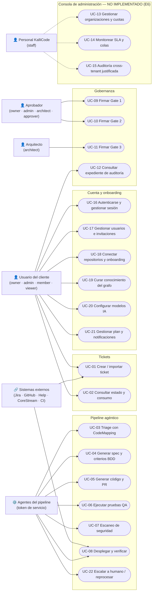
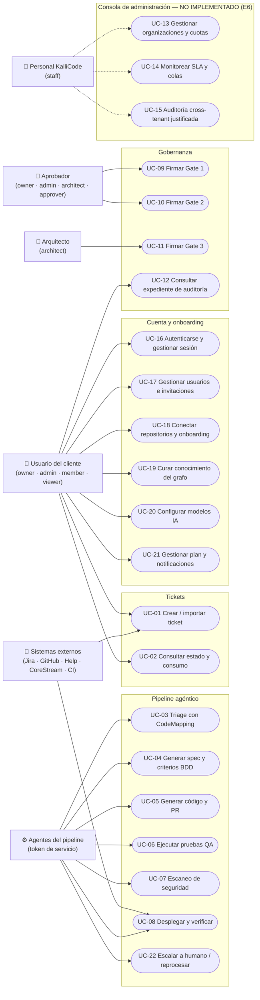

# Diagrama de Casos de Uso y Trazabilidad con la API — KalliCode

**Versión:** `kallicode-backend`, rama `develop`, commit `f04519f` · **Fecha:** 28-10-2026 · **Responsable:** Luis Ibáñez (QA2)
**Método:** los endpoints se extrajeron de los decoradores de los 17 routers (`apps/api/src/kallicode_api/routers/`) y de los prefijos con que `main.py` los monta: `/api/v1` (portal), `/api/v1/webhooks` (integraciones) e `/internal/v1` (agentes). Hay **87 endpoints**, 2 de ellos de salud (`/health`).

## 1. Diagrama

**Actores.** Se representan como **roles del sistema**, no como equipos de desarrollo. Los roles son los del `CHECK` de `core.users`: `owner`, `admin`, `architect`, `approver`, `member`, `viewer`. Quién puede firmar cada gate está **verificado por pruebas** (caso CP-05, matriz RBAC):
- Gates 1 y 2: `owner`, `admin`, `architect`, `approver`. `member` y `viewer` reciben HTTP 403.
- Gate 3 (paso a producción): **solo `architect`**, ni siquiera `owner`.

## 2. Trazabilidad: caso de uso → endpoints → pruebas

| UC | Caso de uso | Endpoints que lo implementan | Pruebas relacionadas | Estado |
|---|---|---|---|---|
| UC-01 | Crear / importar ticket | `POST /api/v1/tickets` · `POST /api/v1/tickets/features` · `POST /api/v1/tickets/dedup-preview` · `POST /api/v1/tickets/impact-preview` · `POST /api/v1/tickets/attachments` · `POST /api/v1/webhooks/{jira, github, kallicode-help, corestream}/{token}` | CP-01 (aislamiento RLS) | ✅ |
| UC-02 | Consultar estado y consumo | `GET /api/v1/tickets` · `GET /api/v1/tickets/{numero}` · `…/activity` · `…/usage` · `GET /api/v1/dashboard/{summary, lines, kanban}` · `GET /api/v1/usage/{summary, by-ticket}` | CP-01 | ✅ |
| UC-03 | Triage con CodeMapping | `POST /internal/v1/jobs` · `POST /internal/v1/jobs/{id}/assign` · `POST /internal/v1/jobs/{id}/steps` · `POST /internal/v1/tickets/{numero}/triage-result` | — | ✅ endpoints |
| UC-04 | Generar spec y criterios BDD | `POST /internal/v1/tickets/{numero}/spec-versions` · `GET /api/v1/tickets/{numero}/spec` | — | ✅ endpoints |
| UC-05 | Generar código y PR | `PATCH /internal/v1/jobs/{id}/state` · `POST /internal/v1/jobs/{id}/steps` | — | ⚠️ Sin endpoint específico de PR (la URL se guarda en `core.tickets.pr_url`) |
| UC-06 | Ejecutar pruebas QA | `POST /internal/v1/tickets/{numero}/evidence` · `GET /api/v1/tickets/{numero}/evidence` | CP-07 (sandbox), CP-16 (módulo testing) | ✅ endpoints |
| UC-07 | Escaneo de seguridad | `POST /internal/v1/tickets/{numero}/findings` · `GET /api/v1/tickets/{numero}/security` | — | ✅ endpoints |
| UC-08 | Desplegar y verificar | `POST /internal/v1/tickets/{numero}/deploy/preflight` · `…/deploy/result` · `POST /api/v1/webhooks/ci/{token}` | — | ✅ endpoints |
| UC-09/10/11 | Firmar Gate 1, 2 y 3 | `GET /api/v1/approvals/pending` · `GET /api/v1/tickets/{numero}/gates` · `POST /api/v1/tickets/{numero}/gates/{gate}/approve` · `…/request-changes` | **CP-05** (matriz RBAC, 18 ejecuciones) | ✅ |
| UC-12 | Consultar expediente de auditoría | `GET /api/v1/audit/events` · `GET /api/v1/audit/tickets/{numero}` · `GET /api/v1/audit/steps/{step_id}` · `POST /api/v1/audit/exports` · `GET /api/v1/audit/exports/{id}` · `GET /api/v1/audit/integrity` | CP-08 (logs por tenant) | ✅ |
| UC-13/14/15 | Consola de administración | — (no existe `/admin/v1`) | — | ❌ No iniciado (E6) |
| UC-16 | Autenticarse y gestionar sesión | `POST /api/v1/auth/{login, refresh, logout, forgot-password, reset-password, invitations/accept}` | **CP-04** (JWT: 5 ataques) | ✅ |
| UC-17 | Gestionar usuarios e invitaciones | `GET/PATCH /api/v1/users/me` · `GET /api/v1/users` · `POST /api/v1/users/invitations` · `PATCH /api/v1/users/{id}` · `GET/PATCH /api/v1/organization` | CP-01 | ✅ |
| UC-18 | Conectar repositorios y onboarding | `GET/POST /api/v1/onboarding/connections` · `PATCH/DELETE …/{id}` · `POST …/{id}/test` · `PUT …/branch-map` · `POST /api/v1/onboarding/documents` · `GET /api/v1/onboarding/codemapping/status` · `POST /api/v1/onboarding/complete` | CP-06 (secretos) | ✅ |
| UC-19 | Curar conocimiento del grafo | `GET /api/v1/codemapping/curation` · `…/selectores` · `…/{item_id}` · `POST …/{item_id}/decision` | — | ✅ |
| UC-20 | Configurar modelos IA | `GET /api/v1/models/providers` · `PUT …/{proveedor}` · `GET /api/v1/models/assignments` | — | ✅ |
| UC-21 | Gestionar plan y notificaciones | `GET /api/v1/plans` · `POST /api/v1/plans/upgrade-request` · `GET /api/v1/notifications` · `PATCH …/{id}` · `POST …/read-all` | — | ✅ |
| UC-22 | Escalar a humano / reprocesar | `POST /internal/v1/escalations` · `GET /internal/v1/metrics/dlq` · `POST /internal/v1/dlq/reprocesar` · `POST /internal/v1/usage/loc` | — | ✅ endpoints |

**Lectura de la tabla:**
- "✅ endpoints" significa que la API existe. El flujo automático completo depende del orquestador, cuyas transiciones automáticas están pendientes (ver *Diagrama de Actividades*, sección 3).
- La columna de pruebas muestra que los casos de uso más críticos para la seguridad (autenticación, gates y aislamiento) están cubiertos por la suite del Equipo 5. **Los casos de uso del pipeline (UC-03 a UC-08) no tienen todavía pruebas de la suite transversal.** Es una brecha para el próximo bloque.

## 3. Diferencias con el diagrama anterior (`Diagrama_de_casos_de_Uso.md`)

- **Se mantienen** los 15 casos de uso originales (UC-01 a UC-15), con la misma numeración.
- **Se agregan UC-16 a UC-22:** tienen endpoints implementados (38 en total) pero no figuraban en el diagrama. Autenticación, usuarios, onboarding, curación, modelos IA, planes, notificaciones y operación interna.
- **Actores:** el diagrama anterior usaba equipos de desarrollo como actores ("Cliente / Portal (E4)", "Aprobador (E3)"). En UML un actor es un **rol que interactúa con el sistema**, no el equipo que lo construye. Se reemplazaron por los roles reales del sistema.
- **UC-13 a UC-15** se marcan explícitamente como **no implementados** (Consola de Administración, Equipo 6).
