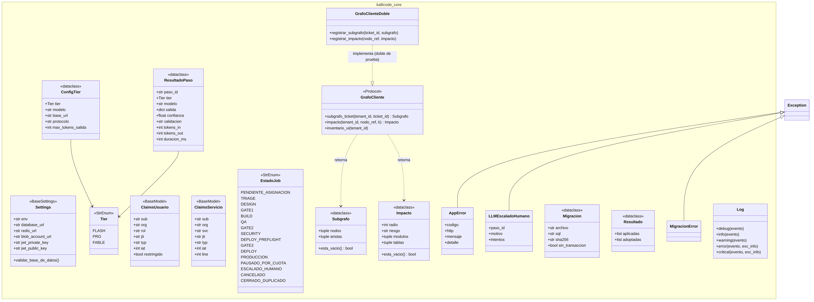
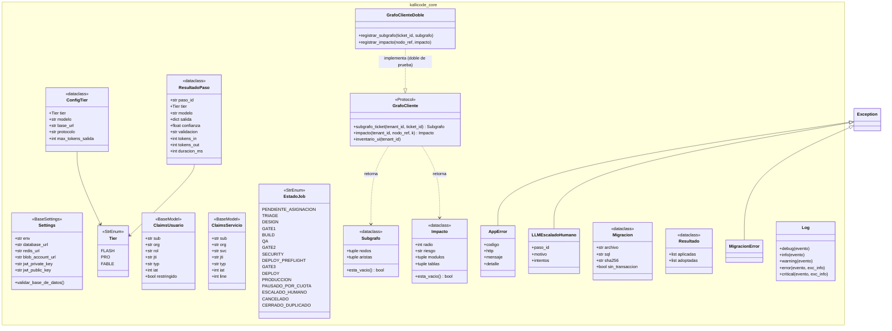
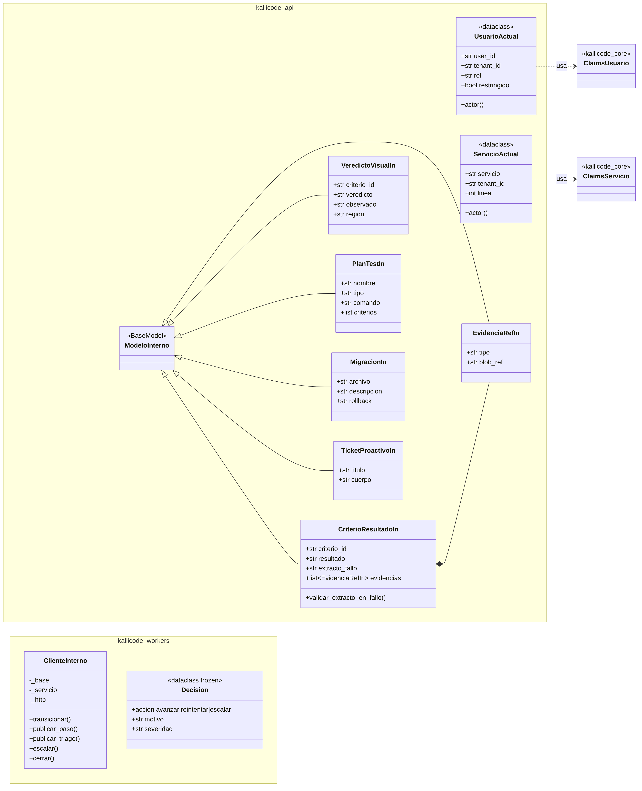
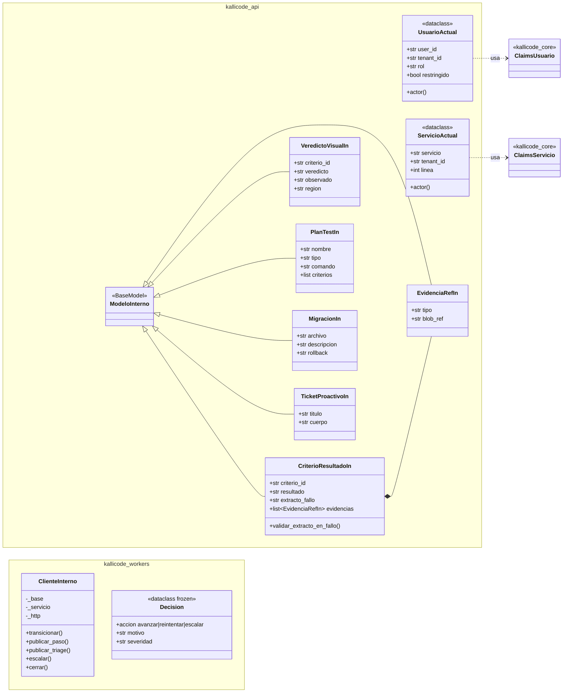
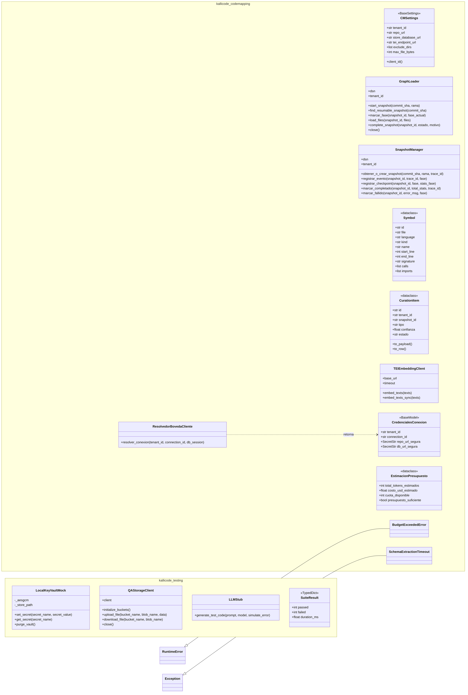
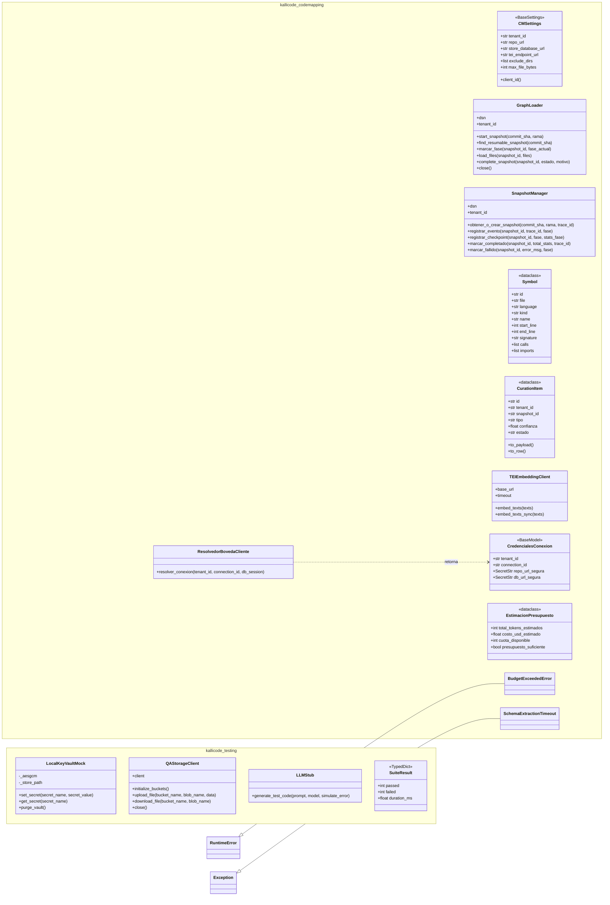

# Diagrama de Clases — KalliCode (implementación)

**Versión:** `kallicode-backend`, rama `develop`, commit `f04519f` · **Fecha:** 28-10-2026 · **Responsable:** Luis Ibáñez (QA2)
**Método:** las clases, atributos, métodos y herencias se extrajeron analizando el código fuente con el módulo `ast` de Python (sin ejecutarlo). Solo se dibujan las relaciones confirmadas en el código: herencia declarada, tipos de atributos y de retorno, e imports.

## 1. Lo primero: cómo está construido el backend

El backend **no usa un ORM**: no hay modelos SQLAlchemy ni clases de dominio como `Ticket` o `Job` con métodos propios. La arquitectura es **funcional por capas**:

```
 Petición HTTP
      │
      ▼
 routers/ (15)  ── funciones FastAPI por recurso; validan entrada con DTOs Pydantic
      │
      ▼
 servicios/ + kallicode_core ── lógica compartida: seguridad, sesión con RLS, LLM, auditoría
      │
      ▼
 SQL directo (asyncpg) ── la base de datos aplica las reglas: RLS, CHECK, triggers
                          (correlativo KC-####, historial de estados, sello de auditoría)
```

Las clases que existen son de **infraestructura**: configuración, contratos de datos (DTOs), clientes de servicios externos, enums y errores. Las **reglas de negocio** viven en los routers, en las funciones de `kallicode_core` y en la propia base de datos (restricciones y triggers). Por eso el modelo de datos está en el MER y aquí se muestra la estructura de clases del código.

**Inventario:** 95 clases en el código de producción (sin pruebas).

| Paquete | Clases | Qué son |
|---|---:|---|
| `apps/api` | 55 | 51 DTOs Pydantic de entrada/salida (7 en `esquemas/interna.py` + 44 en los routers), 2 clases de contexto de petición y 2 middlewares |
| `packages/core` | 20 | Configuración, errores, claims JWT, enums del pipeline y del LLM, contrato del grafo, migraciones, log |
| `packages/codemapping` | 14 | Ingesta del grafo: cargador, snapshots, parser, embeddings, bóveda |
| `packages/testing` | 4 | Utilidades de QA: bóveda local, almacenamiento Azurite, stub LLM |
| `apps/workers` | 2 | Cliente de la API interna y decisión del orquestador |

## 2. Diagramas

### 2.1 Núcleo compartido (`packages/core`)



Lo más relevante:
- **`EstadoJob`** es la máquina de estados del pipeline: 16 estados, incluidos los tres gates humanos (`GATE1`, `GATE2`, `GATE3`) y los estados de excepción (`PAUSADO_POR_CUOTA`, `ESCALADO_HUMANO`).
- **`Tier`** (flash → pro → fable) son los tres niveles de modelo LLM. `ResultadoPaso` registra cada llamada: tokens, duración, confianza y validación.
- **`GrafoCliente`** es un `Protocol`, una interfaz: define *qué* debe ofrecer el grafo sin atarse a una implementación. `GrafoClienteDoble` es su **doble de prueba**, que aplica la regla de desbloqueo del Plan de Programa (§9.3): trabajar contra el contrato mientras otro equipo implementa.
- **`ClaimsUsuario`** y **`ClaimsServicio`** son el contenido de los JWT, con un token distinto para personas y para servicios internos.



### 2.2 API y workers (`apps/api`, `apps/workers`)



- **`UsuarioActual`** y **`ServicioActual`** representan *quién* hace la petición. Se construyen a partir de los claims del JWT y llevan el `tenant_id` con que se abre la sesión RLS.
- **`ModeloInterno`** es la base de los contratos de la API interna `/internal/v1`, la que usan los agentes del pipeline. `CriterioResultadoIn` **compone** una lista de `EvidenciaRefIn`: cada resultado de un criterio de aceptación lleva sus evidencias.
- **`ClienteInterno`** es el cliente que usa el orquestador para mover un job entre estados. **`Decision`** es la salida de la política del orquestador: avanzar, reintentar o escalar a un humano.
- No se dibujan los middlewares de seguridad (`CabecerasSeguridadMiddleware`, `LimiteCuerpoMiddleware`) ni los 44 DTOs de los routers. Se listan en la sección 3.



### 2.3 CodeMapping y utilidades de pruebas (`packages/codemapping`, `packages/testing`)



- **`GraphLoader`** y **`SnapshotManager`** cargan el grafo del código del cliente en el esquema `cm`, una foto (*snapshot*) por cada ingesta. Esto conecta con `cm.repo_snapshots` del MER.
- **`ResolvedorBovedaCliente`** obtiene las credenciales del cliente desde la bóveda y las entrega como `SecretStr`, que no se imprimen en los logs.
- En `kallicode_testing`, **`LocalKeyVaultMock`** (cifrado AES-GCM), **`QAStorageClient`** (Azurite) y **`LLMStub`** son los dobles que permiten probar sin nube. Son los mismos que ejercitan los casos de prueba CP-06, CP-15 y CP-13.



## 3. Contratos de la API (DTOs Pydantic en los routers)

| Router | DTOs |
|---|---|
| `auth` | LoginIn, TokensOut, RefreshIn, LogoutIn, ForgotIn, ResetIn, AcceptIn |
| `internal` | JobIn, AssignIn, StateIn, StepIn, TriageResultIn, AlternativaIn, CriterioSpecIn, SpecIn, EvidenciaIn, HallazgoIn, FindingsIn, PreflightIn, DeployResultIn, LocIn, EscalationIn, DlqReprocesarIn |
| `tickets` | TicketIn, CriterioIn, FeatureIn, PreviewIn, TicketPatch, AdjuntoIn, WatcherIn |
| `connections` | ConexionIn, ConexionPatch, BranchMapIn, DocIn |
| `users` | MePatch, InviteIn, UserPatch |
| `gates` | FirmaIn, CambiosIn |
| `audit` · `curation` · `notifications` · `organization` · `plans` | ExportIn · CuracionDecisionIn · LeidaIn · OrgPatch · UpgradeIn |

## 4. Relación con el diagrama de clases anterior (`Diagrama_de_Clases.md`)

El diagrama anterior muestra 10 clases de dominio (`Organization`, `User`, `Ticket`, `Spec`, `Job`…) con 16 métodos. Se contrastaron con el código:

- **Las 10 clases corresponden a tablas reales** de la base (ver MER), así que el modelo de datos que representan es correcto.
- **15 de los 16 métodos no existen en el código** (`avanzar_etapa`, `aprobar_spec`, `firmar_digitalmente`, `generar_jwt_pair`, `verificar_cuota_loc`…). Solo `transicionar` existe, y está en `ClienteInterno`, no en una clase `Job`.

**Recomendación:** mantener ese diagrama, pero **renombrarlo como "Modelo de dominio (conceptual)"** y aclarar que sus operaciones describen *qué* hace el sistema, no *dónde* está el código. Este documento queda como diagrama de clases **de implementación**. Así ambos son correctos y ninguno se contradice con el repositorio.

## 5. Hallazgo detectado durante el análisis

| ID | Hallazgo | Ubicación | Impacto |
|---|---|---|---|
| H-06 | El archivo de inicialización del paquete del orquestador está mal nombrado: `__init_.py` (un guion bajo final) en lugar de `__init__.py` | `apps/workers/src/kallicode_workers/orquestador/__init_.py` | Python no lo ejecuta como inicializador del paquete, así que sus exportaciones (`__all__ = ["ClienteInterno", "Decision", "ciclo", "decidir"]`) no se cargan; el paquete funciona solo como *namespace package*. Corresponde reportarlo al equipo dueño del orquestador (E2) |
