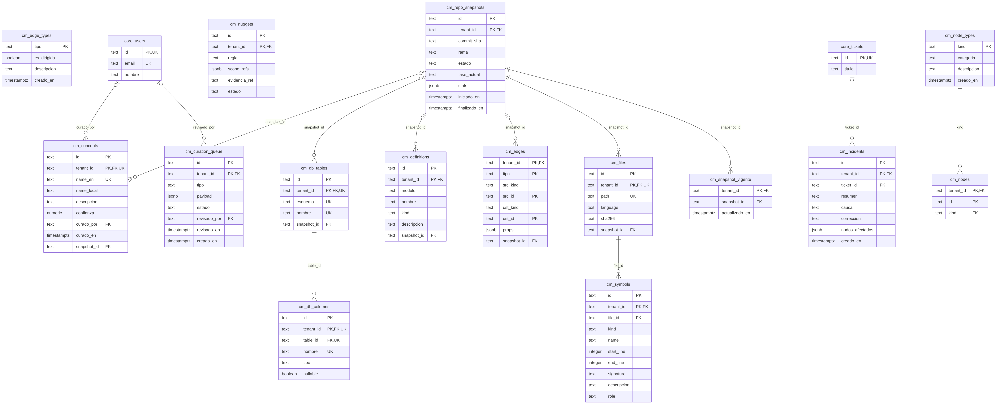
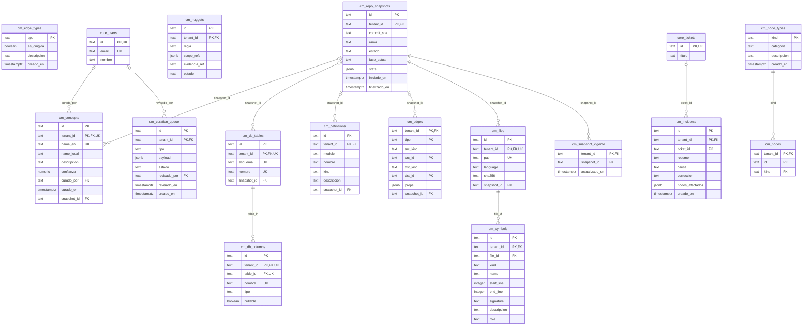
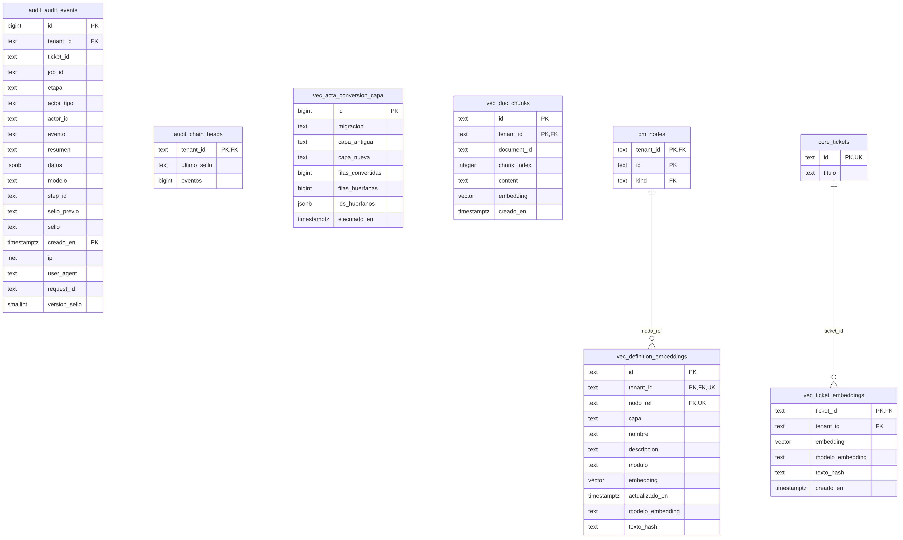
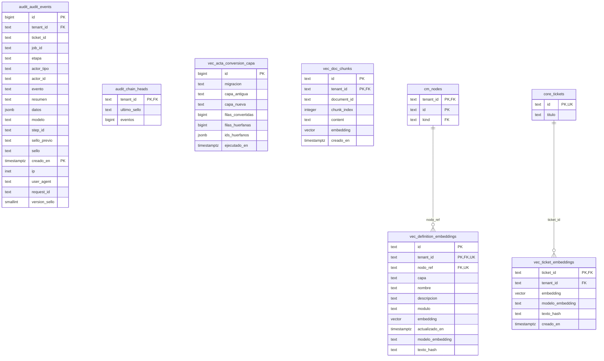

# Modelo Entidad-Relación — Esquemas `cm`, `vec` y `audit` · KalliCode

**Versión de la base de datos:** `kallicode-backend`, rama `develop`, commit `f04519f` · **Fecha:** 28-10-2026 · **Responsable:** Luis Ibáñez (QA2)
**Método:** el mismo que en `MER_core_KalliCode.md`. Los diagramas se generaron desde el catálogo de una base PostgreSQL 16 construida con los scripts reales del repositorio.

Convenciones: toda tabla con `tenant_id` referencia a `core.organizations` (no se dibuja). Las FK entre tablas son compuestas `(tenant_id, x_id)`. Las entidades de otros esquemas (`core_users`, `core_tickets`, `cm_nodes`) aparecen solo como referencia.

## E. Esquema cm — Grafo de conocimiento del código (CodeMapping)

| Tabla | Características | ¿Estaba en el MER anterior? |
|---|---|---|
| `cm.concepts` | RLS forzado | **Nueva** |
| `cm.curation_queue` | RLS forzado | **Nueva** |
| `cm.db_columns` | RLS forzado | **Nueva** |
| `cm.db_tables` | RLS forzado | **Nueva** |
| `cm.definitions` | RLS forzado | **Nueva** |
| `cm.edge_types` | sin RLS (catálogo global / técnica) | **Nueva** |
| `cm.edges` | RLS forzado | **Nueva** |
| `cm.files` | RLS forzado | **Nueva** |
| `cm.incidents` | RLS forzado | **Nueva** |
| `cm.node_types` | sin RLS (catálogo global / técnica) | **Nueva** |
| `cm.nodes` | RLS forzado | **Nueva** |
| `cm.nuggets` | RLS forzado | **Nueva** |
| `cm.repo_snapshots` | RLS forzado | **Nueva** |
| `cm.snapshot_vigente` | RLS forzado | **Nueva** |
| `cm.symbols` | RLS forzado | **Nueva** |

**Para entender este esquema:**
- `cm` guarda el **grafo de conocimiento del código del cliente**: archivos, símbolos (funciones y clases), tablas y columnas de su base de datos, definiciones y conceptos de negocio. Antes vivía en Neo4j y Qdrant; la decisión **D18** lo trasladó a PostgreSQL para tener un solo motor y el mismo aislamiento RLS.
- `repo_snapshots` es el centro: cada ingesta de un repositorio genera una foto (commit y rama), y casi todo cuelga de ella. `snapshot_vigente` apunta a la foto activa de cada tenant.
- **`cm.edges` no tiene FK hacia los nodos, y es intencional.** Es una tabla de aristas *polimórfica*: `src_kind`/`dst_kind` indican si el extremo es un archivo, símbolo, tabla, columna, definición o concepto, y un `CHECK` restringe esos valores y el `tipo` de arista (`DEFINES`, `CALLS`, `HAS_COLUMN`, `REFERENCES`, `USES_TABLE`, `REALIZED_BY`, `RELATES`, `EXPRESSES`). Es el patrón habitual para representar un grafo en una base relacional.
- `node_types` y `edge_types` son catálogos globales (iguales para todos los clientes), por eso no tienen RLS.

## F. Esquemas vec y audit — Embeddings y cadena de auditoría

| Tabla | Características | ¿Estaba en el MER anterior? |
|---|---|---|
| `audit.audit_events` | particionada, RLS forzado | Sí |
| `audit.chain_heads` | RLS forzado | Sí |
| `vec.acta_conversion_capa` | sin RLS (catálogo global / técnica) | **Nueva** |
| `vec.definition_embeddings` | particionada, RLS forzado | Sí |
| `vec.doc_chunks` | particionada, RLS forzado | Sí |
| `vec.ticket_embeddings` | RLS forzado | Sí |

**Para entender estos esquemas:**
- **`vec`** guarda los *embeddings* (vectores numéricos del significado de un texto) que usa la búsqueda semántica con pgvector: definiciones del grafo, fragmentos de documentos y tickets (para detectar duplicados). `definition_embeddings` y `doc_chunks` están particionadas por tenant.
- `vec.acta_conversion_capa` es una tabla **técnica**: registra una conversión de datos hecha por una migración. No es de negocio.
- **`audit`** es la cadena de auditoría inmutable. Cada fila de `audit_events` guarda `sello_previo` y `sello` (hash): cada evento queda encadenado al anterior, así que alterar uno rompe la cadena y se detecta. `chain_heads` guarda el último sello de cada tenant.
- **`audit_events` no tiene FK a `tickets` ni a `jobs`, y es intencional.** Un registro de auditoría debe sobrevivir aunque el objeto auditado cambie o se elimine, por eso referencia por identificador lógico y no por clave foránea. Las tablas probatorias son *append-only* (migración `025_append_only_probatorias.sql`).

## Diferencias con el MER anterior (`MER.md`)

- El MER anterior incluía 5 de estas 21 tablas (las de `vec` y `audit`) y **ninguna del esquema `cm`**. Como el esquema `cm` nace de la decisión D18, el modelo anterior no reflejaba ese cambio de arquitectura.
- Con este documento y `MER_core_KalliCode.md` quedan modeladas las **60 tablas** de la base de datos.
