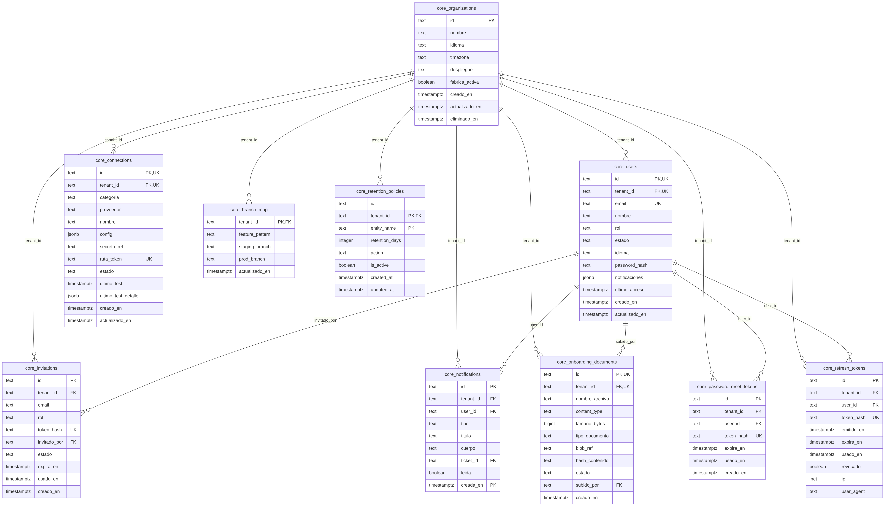
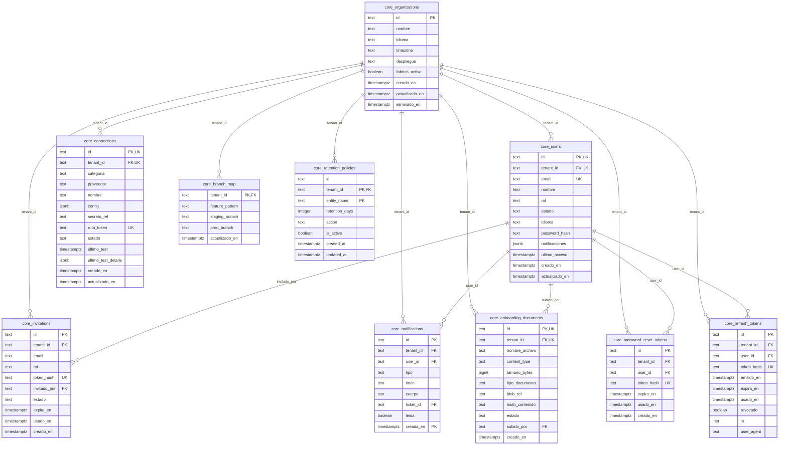
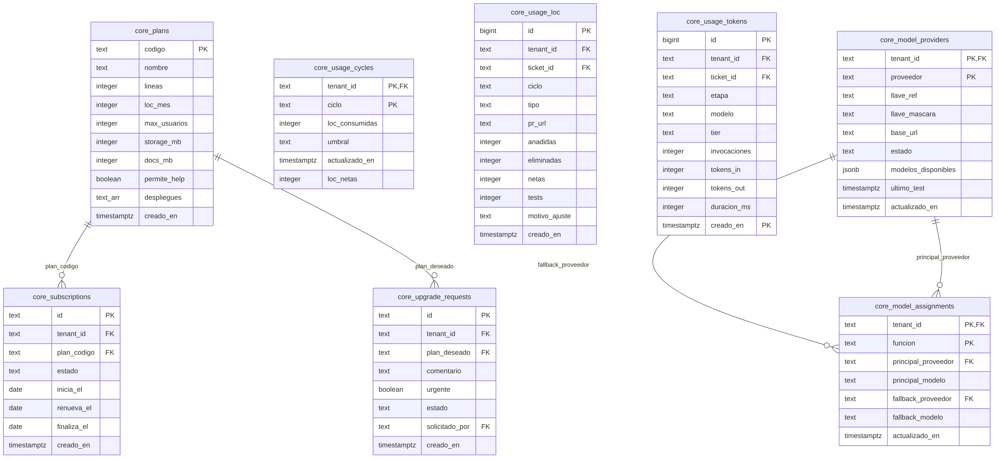
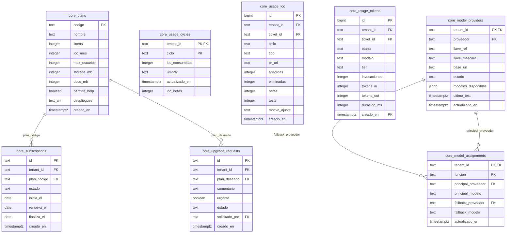
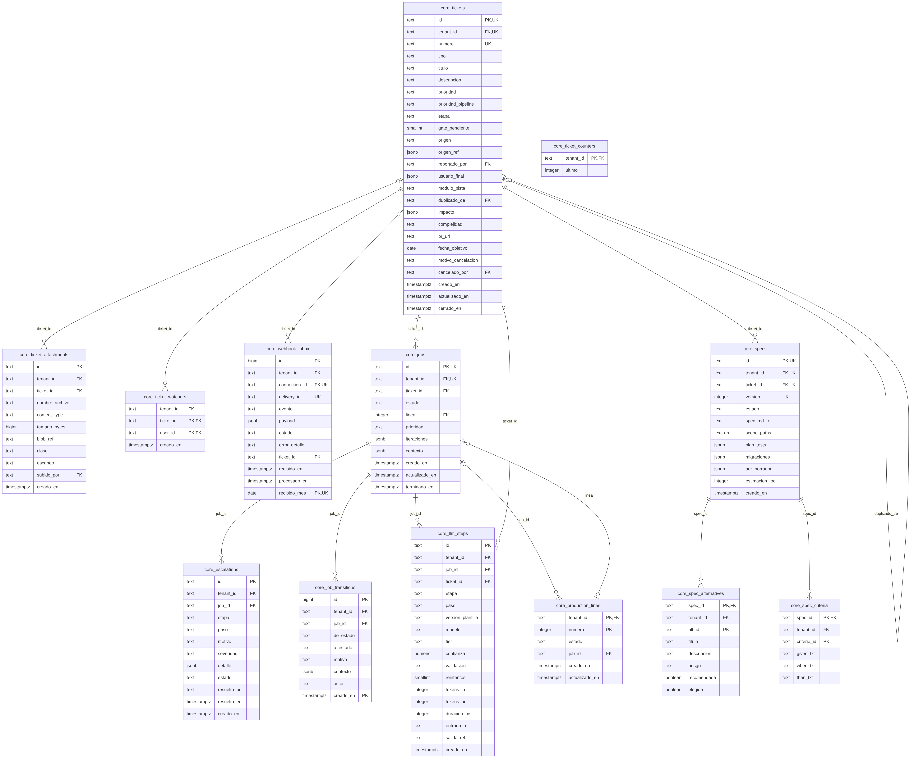
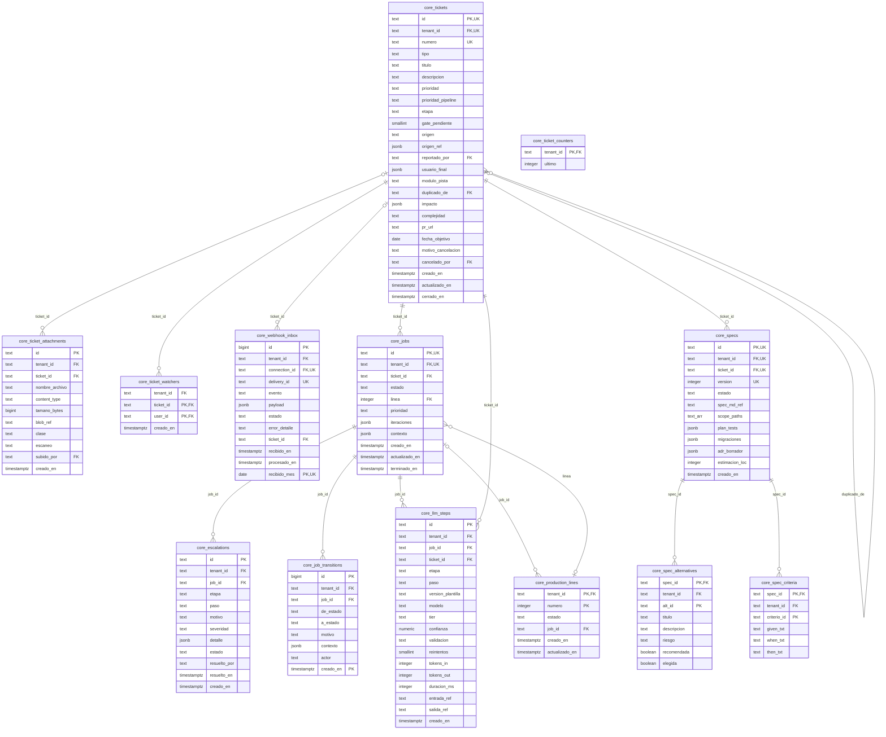
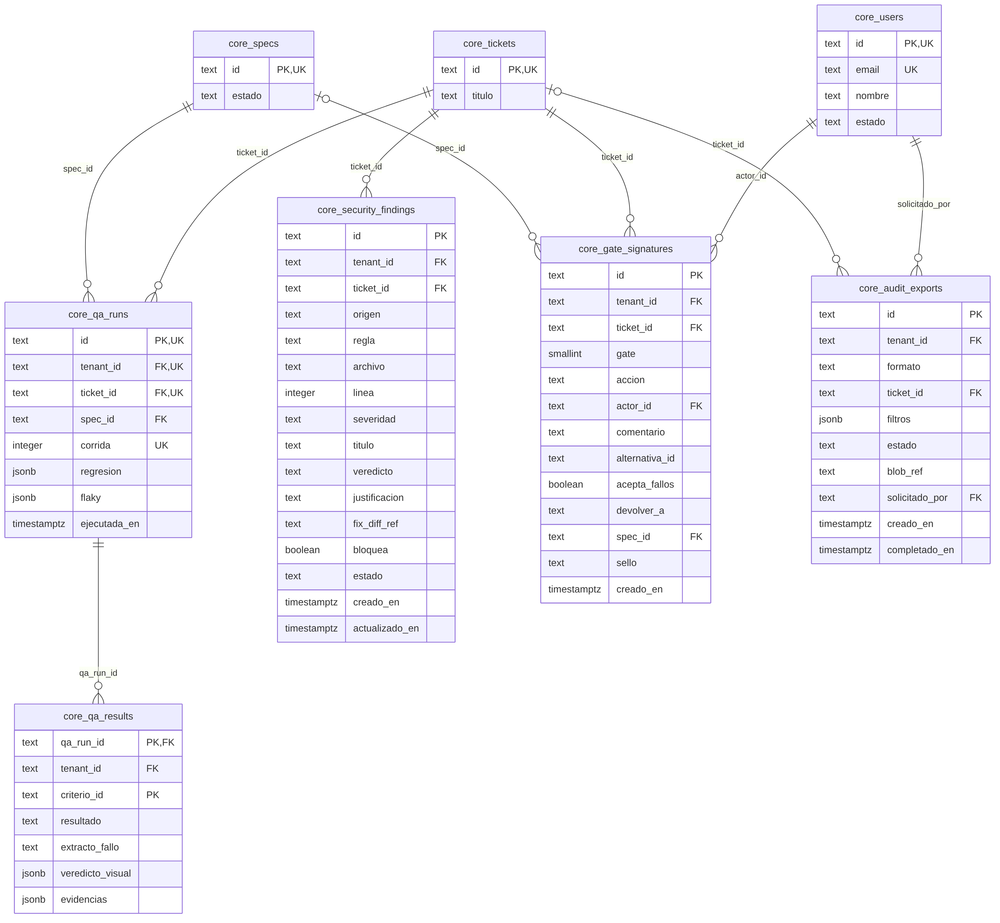
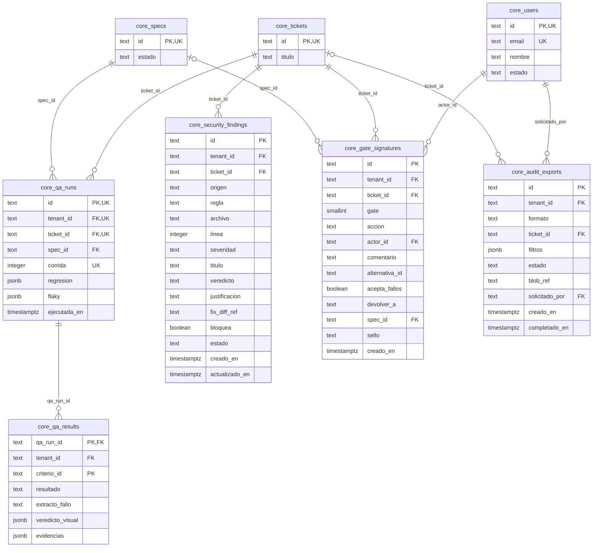

# Modelo Entidad-Relación — Esquema `core` · KalliCode

**Versión de la base de datos:** `kallicode-backend`, rama `develop`, commit `f04519f`
**Fecha:** 28-10-2026 · **Responsable:** Luis Ibáñez (QA2)

**Método.** Se aplicaron los scripts reales del repositorio (`db/00..05.sql` y las 31 migraciones versionadas de `db/migrations/`, con los mismos roles que usa `make db`) sobre un PostgreSQL 16 con pgvector y pg_partman. Los diagramas se generaron leyendo el catálogo de esa base (`pg_class`, `pg_attribute`, `pg_constraint`). **Ninguna tabla, columna ni relación se dibujó a mano.**

## 1. Visión general de la base de datos

```
ESQUEMA   TABLAS   CONTENIDO
core        39     organizaciones, usuarios, tickets, pipeline, calidad, comercial   ← este documento
cm          15     grafo de conocimiento del código (CodeMapping, decisión D18)
vec          4     embeddings vectoriales (pgvector)
audit        2     cadena de auditoría encadenada por hash
─────────────────
TOTAL       60     (sin contar particiones hijas)
```

Evolución del modelo:
```
41 tablas   diseño original (Modelo de Base de Datos, Alloxentric) — core, vec, audit
+15         esquema cm: el grafo de código pasa de Neo4j/Qdrant a PostgreSQL (D18)
 +4         tablas agregadas por migraciones versionadas
 60         estado actual del repositorio
```

## 2. Convenciones del modelo (leer antes de los diagramas)

- **Multi-tenencia.** Toda tabla de negocio tiene `tenant_id`, que referencia a `core.organizations`. Para que los diagramas sean legibles, esa relación **solo se dibuja en el diagrama A**. En los demás está implícita.
- **FK compuestas con tenant.** Las relaciones entre tablas usan claves foráneas compuestas `(tenant_id, x_id)`, no solo `x_id`. Así la base de datos *impide* que una fila de un cliente apunte a una fila de otro cliente (hallazgo DB-F01, cerrado con las migraciones 013–016).
- **Row Level Security.** 36 de las 39 tablas tienen RLS activado y **forzado** (`FORCE ROW LEVEL SECURITY`). Solo quedan fuera `plans`, que es un catálogo global de planes, y dos tablas técnicas.
- **Particionado.** `job_transitions`, `notifications`, `usage_tokens` y `webhook_inbox` están particionadas por fecha con pg_partman. Por eso la fecha forma parte de su clave primaria.
- **Identificadores.** Son ULID de texto con prefijo (`u_`, `org_`, `job_`…), lo que hace trazable cada id.
- **Cardinalidad.** `||--o{` = obligatoria (FK NOT NULL) · `|o--o{` = opcional (FK admite nulo).

## 3. Diagramas

### A. Organización, identidad y acceso



| Tabla | Características | ¿Estaba en el MER anterior? |
|---|---|---|
| `core.organizations` | RLS forzado | Sí |
| `core.users` | RLS forzado | Sí |
| `core.invitations` | RLS forzado | **Nueva** |
| `core.refresh_tokens` | RLS forzado | Sí |
| `core.password_reset_tokens` | RLS forzado | **Nueva** |
| `core.onboarding_documents` | RLS forzado | **Nueva** |
| `core.connections` | RLS forzado | Sí |
| `core.branch_map` | RLS forzado | **Nueva** |
| `core.notifications` | particionada, RLS forzado | **Nueva** |
| `core.retention_policies` | RLS forzado | **Nueva** |



### B. Comercial y consumo



| Tabla | Características | ¿Estaba en el MER anterior? |
|---|---|---|
| `core.plans` | sin RLS (catálogo global) | Sí |
| `core.subscriptions` | RLS forzado | Sí |
| `core.upgrade_requests` | RLS forzado | **Nueva** |
| `core.usage_cycles` | RLS forzado | Sí |
| `core.usage_loc` | RLS forzado | Sí |
| `core.usage_tokens` | particionada, RLS forzado | **Nueva** |
| `core.model_providers` | RLS forzado | **Nueva** |
| `core.model_assignments` | RLS forzado | **Nueva** |



### C. Tickets y pipeline de producción



| Tabla | Características | ¿Estaba en el MER anterior? |
|---|---|---|
| `core.tickets` | RLS forzado | Sí |
| `core.ticket_attachments` | RLS forzado | **Nueva** |
| `core.ticket_counters` | RLS forzado | **Nueva** |
| `core.ticket_watchers` | RLS forzado | Sí |
| `core.webhook_inbox` | particionada, RLS forzado | Sí |
| `core.specs` | RLS forzado | Sí |
| `core.spec_alternatives` | RLS forzado | Sí |
| `core.spec_criteria` | RLS forzado | Sí |
| `core.jobs` | RLS forzado | Sí |
| `core.job_transitions` | particionada, RLS forzado | Sí |
| `core.llm_steps` | RLS forzado | Sí |
| `core.escalations` | RLS forzado | **Nueva** |
| `core.production_lines` | RLS forzado | Sí |



### D. Calidad, gates y evidencia



| Tabla | Características | ¿Estaba en el MER anterior? |
|---|---|---|
| `core.qa_runs` | RLS forzado | Sí |
| `core.qa_results` | RLS forzado | Sí |
| `core.security_findings` | RLS forzado | Sí |
| `core.gate_signatures` | RLS forzado | Sí |
| `core.audit_exports` | RLS forzado | **Nueva** |

En este diagrama, `tickets`, `specs`, `users` aparecen solo como referencia (claves y columnas principales). Su detalle está en los diagramas A y C.



### Tablas técnicas (no se dibujan)

| Tabla | Propósito |
|---|---|
| `core.schema_migrations` | Registro del runner de migraciones (archivo, sha256, fecha de aplicación). |
| `core.retencion_particiones` | Control interno de la retención de particiones (pg_partman). |
| `core.idempotency_keys` | Claves de idempotencia de peticiones; evita procesar dos veces la misma operación. |

## 4. Diferencias con el MER anterior (`MER.md`)

- El MER anterior modelaba **22** de las 39 tablas de `core`. Todas existen en la base real: **no tenía entidades inventadas**.
- Faltaban **17** tablas, que este documento incorpora: `audit_exports`, `branch_map`, `escalations`, `idempotency_keys`, `invitations`, `model_assignments`, `model_providers`, `notifications`, `onboarding_documents`, `password_reset_tokens`, `retencion_particiones`, `retention_policies`, `schema_migrations`, `ticket_attachments`, `ticket_counters`, `upgrade_requests`, `usage_tokens`.
- El MER anterior no mostraba las FK compuestas con `tenant_id` ni las tablas particionadas.

## 5. Pendiente

- MER de los esquemas `cm`, `vec` y `audit`.
- Diccionario de datos (descripción de cada columna).
