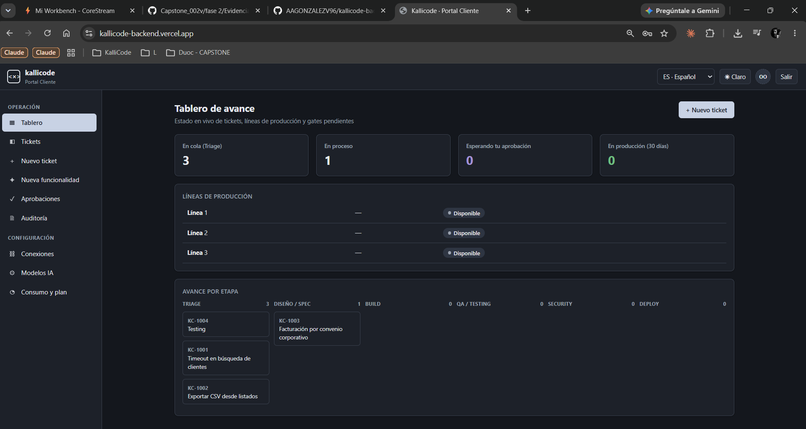
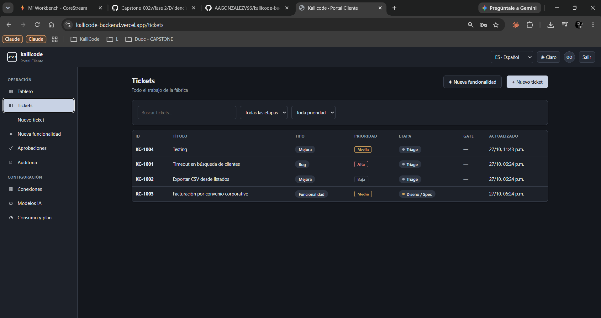

# Evidencias de Sistema — Aplicación · KalliCode

**Fecha de captura:** 29-10-2026 · **Responsable:** Luis Ibáñez (QA2)
**Entorno:** despliegue en Vercel del Portal Cliente y del backend (core) de KalliCode, en `https://kallicode-backend.vercel.app`
**Acceso:** usuario con rol `owner` del tenant de demostración (las credenciales no se publican en el repositorio)

---

## 1. Tablero de avance

**Qué se observa:**
- El usuario inició sesión y el portal muestra el **tablero de avance** del tenant: tickets en cola de triage (3), en proceso (1), esperando aprobación (0) y en producción en los últimos 30 días (0).
- **Líneas de producción:** 3 líneas, todas en estado *Disponible*.
- **Avance por etapa:** el tablero muestra las seis etapas del pipeline (Triage, Diseño/Spec, Build, QA/Testing, Security, Deploy), con los tickets KC-1001, KC-1002 y KC-1004 en Triage y KC-1003 en Diseño/Spec.
- El menú refleja los módulos del portal: Tablero, Tickets, Nuevo ticket, Nueva funcionalidad, Aprobaciones, Auditoría, Conexiones, Modelos IA y Consumo y plan.

## 2. Listado de tickets

**Qué se observa:**
- Listado con filtros por etapa y prioridad y búsqueda de texto.
- Cada ticket muestra su correlativo (**KC-1001 a KC-1004**), tipo (Bug, Mejora, Funcionalidad), prioridad (Alta, Media, Baja), etapa, gate pendiente y fecha de actualización.
- El correlativo `KC-####` empieza en **KC-1001**. Esto coincide con el diseño de la base de datos: el contador por tenant (`core.ticket_counters`) arranca en 1000 y lo asigna un trigger (ver *Diccionario de Datos*).

## 3. Relación con la documentación

| Lo que muestra la aplicación | Dónde está documentado |
|---|---|
| Correlativo KC-#### por tenant | Diccionario de Datos: `core.ticket_counters`, `core.tickets.numero` |
| Etapas Triage → Deploy | Diagrama de Actividades y máquina de estados (`EstadoJob`) |
| Tipos y prioridades de ticket | Diccionario de Datos: valores permitidos (`CHECK`) de `core.tickets` |
| Líneas de producción | MER (`core.production_lines`) |
| Sesión por usuario y rol | Casos de uso UC-16 (autenticación) y prueba CP-04 (JWT) |

**Observación de QA:** los tickets de la captura permanecen en *Triage* y *Diseño/Spec*. Esto es consistente con lo documentado en el *Diagrama de Actividades* (sección 3): las transiciones automáticas del orquestador entre etapas aún están pendientes de implementación (equipo E2).

## 4. Evidencias complementarias

- **Guía de instalación y ejecución local:** `Guia_Instalacion_y_Ejecucion_KalliCode.md` (esta misma carpeta).
- **Ejecuciones de pruebas con capturas de consola:** `Documentos de Diseño/3_Plan_y_Casos_de_Prueba_KalliCode.docx`.
- **Pull requests con evidencia de CI:** repositorio `kallicode-backend` (por ejemplo #91, #92, #137 y #138).
